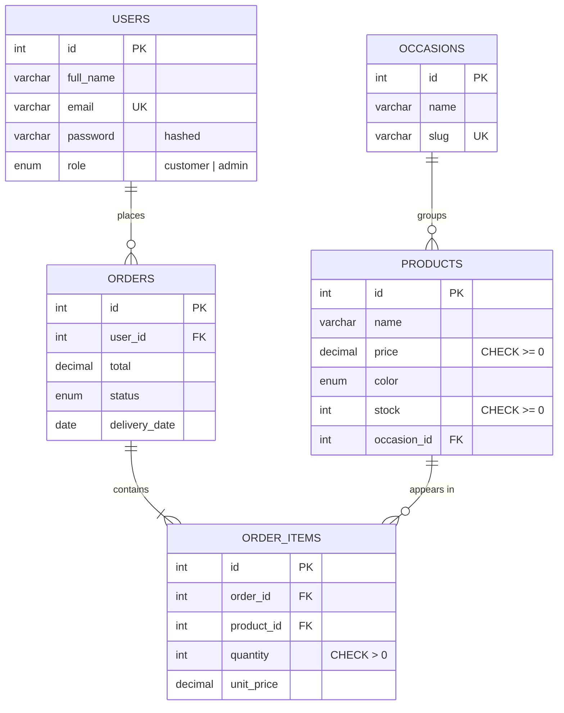
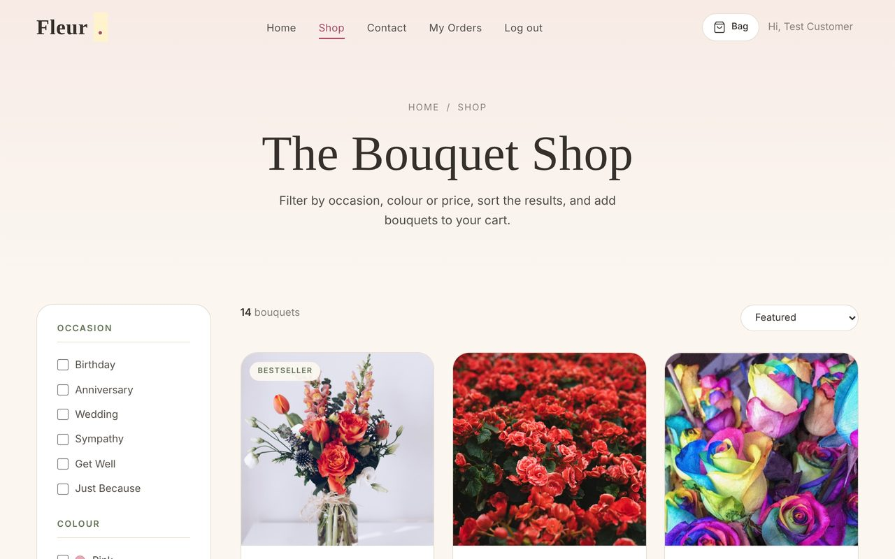
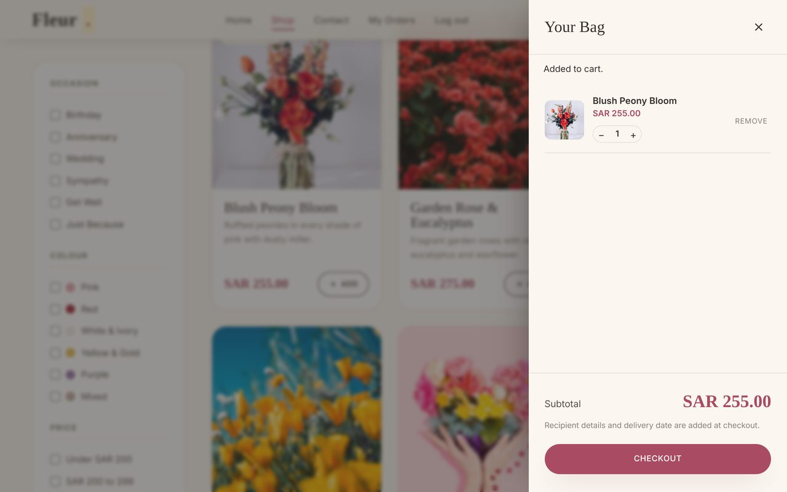
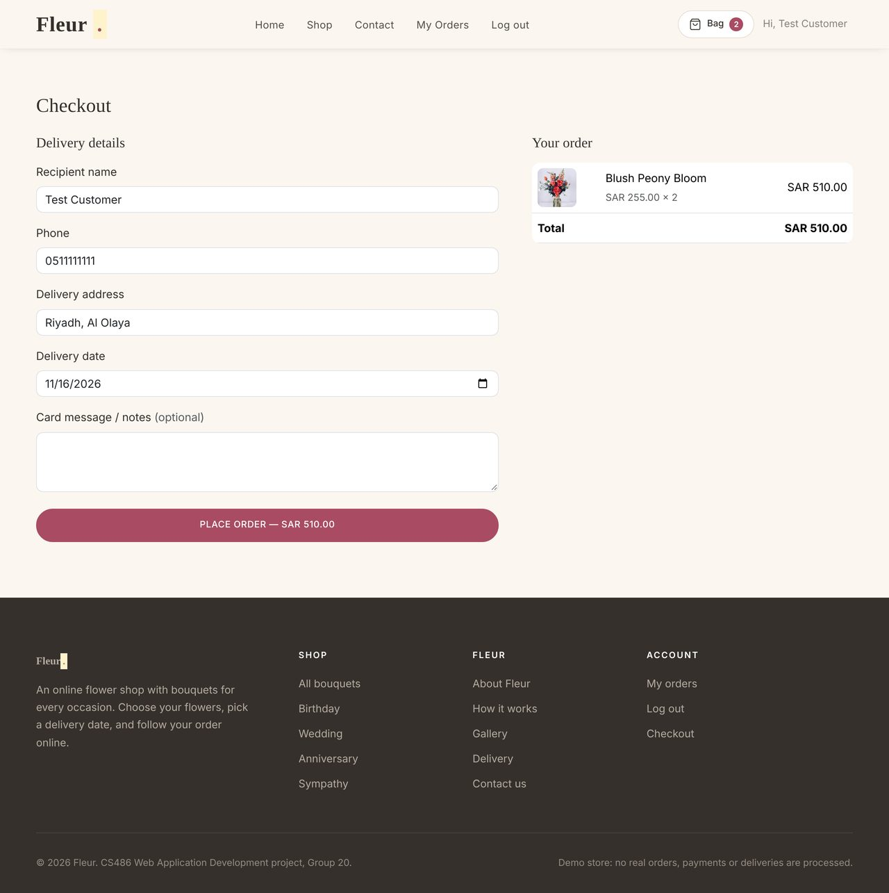
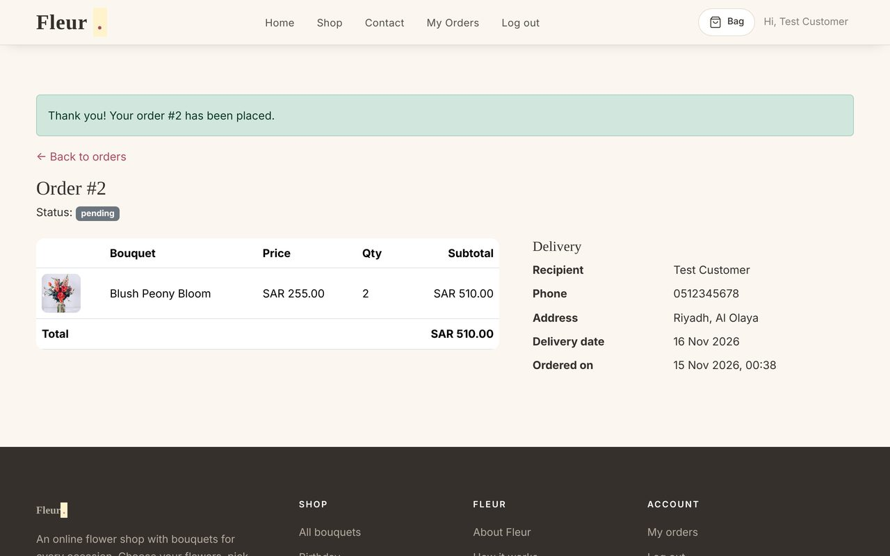
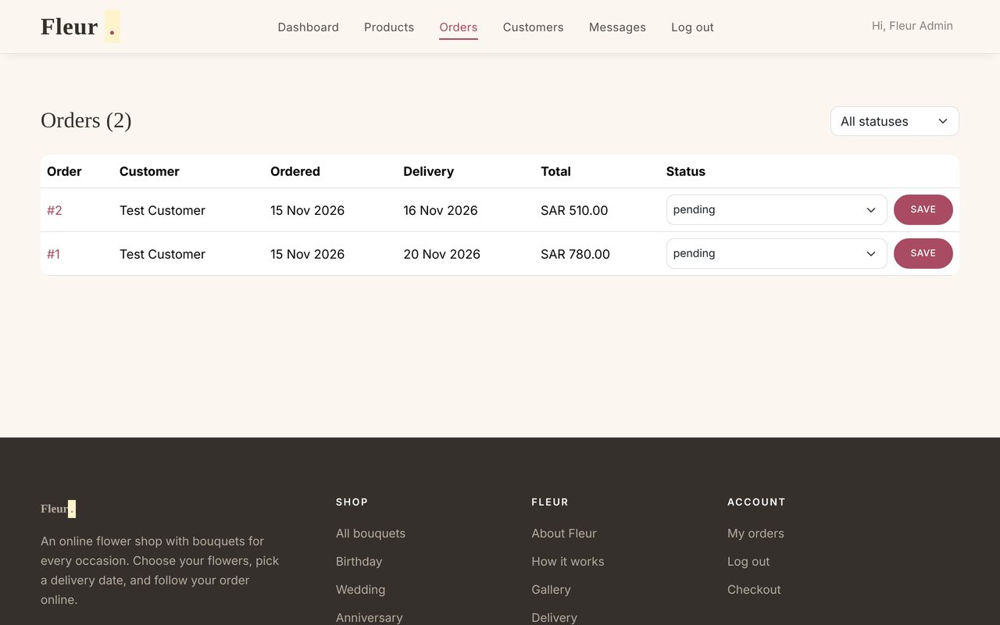
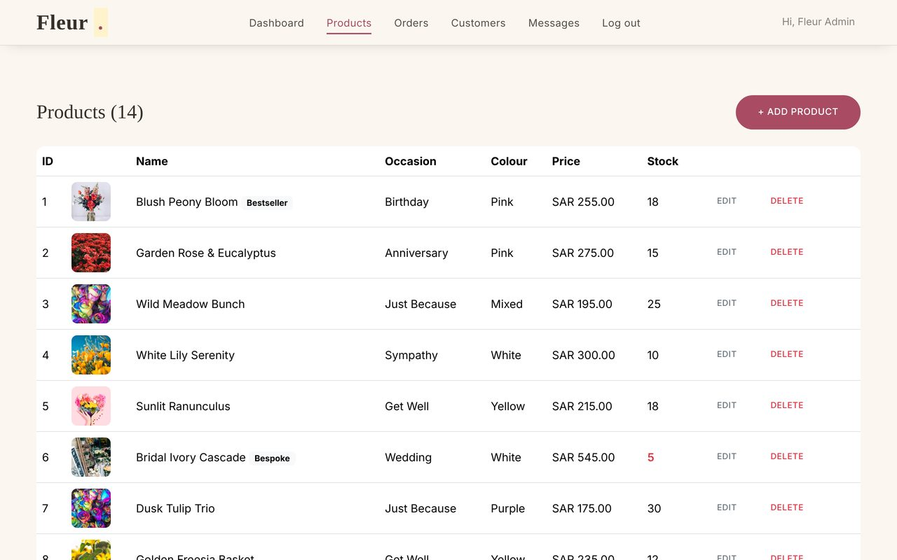
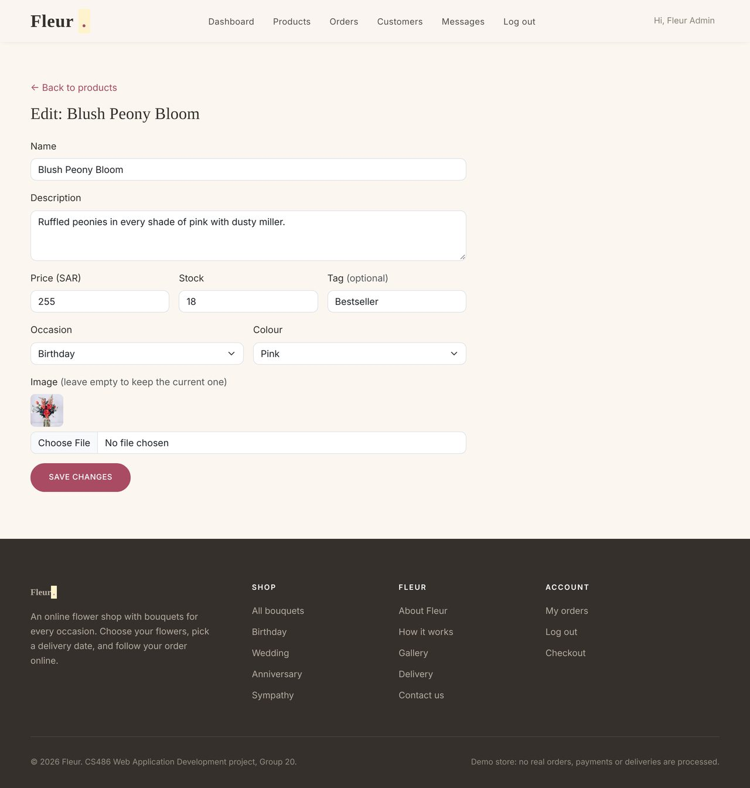
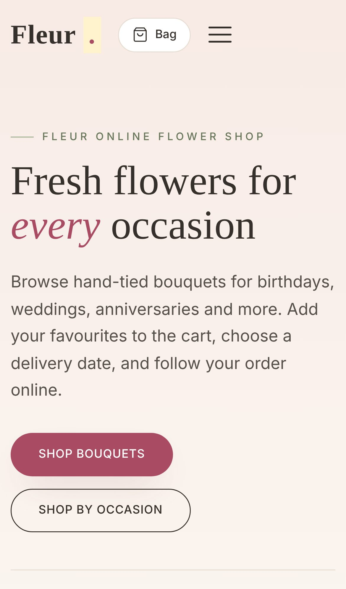
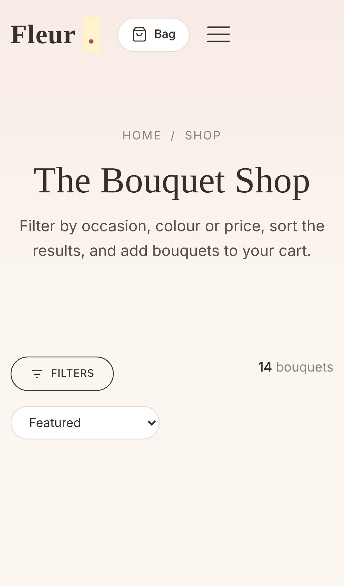

<div align="center">

# 🌷 Fleur: Online Flower Shop

**A full-stack, database-driven e-commerce web application for browsing, ordering and managing flower bouquets.**


*CS486 Web Application Development · Princess Nourah bint Abdulrahman University · 2026*


</div>

---

## 📖 Table of Contents

- [Overview](#-overview)
- [Key Features](#-key-features)
- [Tech Stack](#️-tech-stack)
- [Database Design](#️-database-design)
- [Security](#-security)
- [Screenshots](#-screenshots)
- [Getting Started](#-getting-started)
- [Project Structure](#-project-structure)
- [Team](#-team)
- [Credits](#-credits)

---

## 🌸 Overview

**Fleur** gives customers a simple way to find and order bouquets for any occasion without visiting a physical shop. Customers browse and filter products, manage a live cart, check out with a delivery date, and track their order status. Admins get a dashboard to manage products, orders, customers and messages.

All prices are in Saudi Riyals (SAR). This is an academic demo store: orders are recorded, but no real payments or deliveries take place.

---

## ✨ Key Features

<table>
<tr>
<td width="50%" valign="top">

### 🛍️ Customer side
- Home page with featured bouquets and occasion cards
- Shop with **search, occasion, colour and price filters**, plus sorting
- Product details with stock availability
- **Slide-in AJAX cart**: add, update and remove without reloading
- Register, log in and log out
- Checkout with recipient, address, delivery date and card message
- Order history with live order status
- Contact form and newsletter subscription

</td>
<td width="50%" valign="top">

### 🛠️ Admin side
- **Dashboard**: products, customers, orders, pending orders, revenue and low-stock alerts
- **Products**: full CRUD with image upload
- **Orders**: filter by status and update it; the customer sees changes instantly
- **Stock logic**: cancelling restores stock; re-opening checks stock first
- Customers list with order counts
- Inbox for contact-form messages

</td>
</tr>
</table>

### ⚙️ Business logic highlights
- **Transactional checkout**: product rows are locked, stock is verified, and the order and its items are saved in a single database transaction.
- **Trusted pricing**: prices always come from the database; values sent by the browser are ignored.
- **Price history**: each order item stores its price at purchase time, so past orders never change.
- **Two-layer validation**: JavaScript validates every form in the browser, and PHP re-validates the same rules on the server.

---

## 🛠️ Tech Stack

| Layer | Technology | Usage |
|---|---|---|
| Structure | **HTML5** | Semantic multi-page layout (header, nav, main, section, footer) |
| Styling | **CSS3 + Bootstrap 5** | One shared stylesheet, responsive on desktop, tablet and phone |
| Client logic | **JavaScript** | Validation, filters and sorting, cart drawer, DOM updates |
| Async | **AJAX + JSON** | Cart and newsletter work without page reloads |
| Server | **PHP 8 (OOP)** | Sessions, authentication, business logic, 8 classes |
| Data | **MySQL / MariaDB** | 7 relational tables with PK, FK and CHECK constraints |

---

## 🗄️ Database Design

Seven tables with enforced relationships and integrity constraints. `database/fleur.sql` rebuilds the schema with sample data (14 bouquets, 6 occasions, demo accounts and a sample order).



Standalone tables: `contact_messages` and `newsletter_subscribers`.

| Foreign key | References | Delete rule |
|---|---|---|
| `orders.user_id` | `users.id` | RESTRICT |
| `order_items.order_id` | `orders.id` | **CASCADE**: deleting an order removes its items |
| `order_items.product_id` | `products.id` | **RESTRICT**: products in past orders are protected |
| `products.occasion_id` | `occasions.id` | RESTRICT |

---

## 🔒 Security

| Threat | Protection |
|---|---|
| SQL injection | PDO prepared statements for every query; ids cast to integers |
| XSS | All output escaped through `htmlspecialchars` |
| CSRF | Token on every form and in the `X-CSRF-Token` header for AJAX |
| Password theft | `password_hash()` / `password_verify()` |
| Brute force | 60-second pause after 5 failed login attempts |
| Session hijacking | `session_regenerate_id()` on login; HttpOnly, SameSite=Lax cookies |
| Unauthorized access | Role check on every admin page; customers see only their own orders |
| Malicious uploads | Image type checked from file content, random names, scripts blocked in uploads folder |
| Information leaks | Errors are logged, never shown; users never see SQL or stack traces |

---

## 📸 Screenshots

<table>
<tr>
<td align="center"><br><b>Shop with filters</b></td>
<td align="center"><br><b>AJAX cart drawer</b></td>
</tr>
<tr>
<td align="center"><br><b>Checkout</b></td>
<td align="center"><br><b>Order details</b></td>
</tr>
<tr>
<td align="center"><br><b>Admin dashboard</b></td>
<td align="center"><br><b>Order management</b></td>
</tr>
<tr>
<td align="center"><br><b>Product management</b></td>
<td align="center"><br><b>Add / edit product</b></td>
</tr>
</table>

<details>
<summary><b>📱 Mobile views</b></summary>
<br>
<p align="center">

&nbsp;&nbsp;

</p>
</details>

More screenshots are in [`docs/screenshots`](docs/screenshots).

---

## 🚀 Getting Started

### Requirements
- **PHP 8.0+** with `mbstring` and `pdo_mysql` (enabled by default in XAMPP)
- **MySQL 8.0.16+** or **MariaDB 10.2+** (needed for CHECK constraints)
- Apache, for example through [XAMPP](https://www.apachefriends.org)

### Installation

1. **Clone the repository** into your XAMPP `htdocs` folder:
   ```bash
   cd C:\xampp\htdocs
   git clone https://github.com/Layan-alzuhair/fleur-online-flower-shop.git fleur
   ```
2. **Start Apache and MySQL** from the XAMPP Control Panel.
3. **Import the database**: open `http://localhost/phpmyadmin`, choose **Import**, select `database/fleur.sql`, then click **Go**.
   > ⚠️ The script starts with `DROP DATABASE IF EXISTS fleur;` and will replace any existing `fleur` database.
4. **Configure the connection**:
   ```bash
   cp config/database.example.php config/database.php
   ```
   The defaults (`root`, empty password) match a fresh XAMPP install. `config/database.php` is git-ignored.
5. **Open the site** at `http://localhost/fleur/`

### Demo accounts

| Role | Email | Password |
|---|---|---|
| Admin | `admin@fleur.test` | `Admin@123` |
| Customer | `customer@fleur.test` | `Admin@123` |

> These accounts are for local testing only.

### Quick test
1. Log in as the customer, add bouquets to the cart, check out, and open **My Orders**.
2. Log in as the admin, change the order's status, and confirm the customer sees it.
3. Cancel the order as admin and confirm the stock goes back up.

---

## 📁 Project Structure

```
fleur/
├── index.php · shop.php · product.php     Storefront pages
├── checkout.php · my-orders.php · order-details.php
├── login.php · register.php · logout.php · contact.php
│
├── admin/        Dashboard, products CRUD, orders, customers, messages
├── ajax/         cart.php, newsletter.php (JSON endpoints)
├── classes/      Database, User, Product, Cart, Order, Contact, Newsletter, AppException
├── includes/     init, auth, form helpers, header, footer
├── config/       database.example.php
├── css/ · js/    style.css, main.js
├── img/          Product images (uploads/ holds admin uploads)
├── database/     fleur.sql (schema + sample data)
└── docs/         Screenshots
```

---

## 👩‍💻 Team

Group project developed by **Group 20**. The work was split by technology layer, with shared contracts for table names, form fields and JSON formats.

| Member | Responsibility |
|---|---|
| Areen Alrowaily | PHP: authentication, classes, CRUD, checkout and order logic, AJAX endpoints |
| Aryam Mohammed | JavaScript + AJAX: validation, filters and sorting, cart interaction |
| **Layan Khalid Alzuhair** | **MySQL: database schema, relationships, ERD, SQL export, sample data and queries** |
| Wasan Almasaid | HTML + CSS: page structure, template adaptation, responsive styling |

---

## 🙏 Credits

The front-end design is based on the free **[Fleur template by uiCookies](https://uicookies.com/downloads/fleur/)** (free for personal and commercial use). Demo photos come with the template; all marketing text was rewritten to describe this project's features.

<div align="center">
<br>
<sub>Built with 💗 for CS486 Web Application Development</sub>
</div>
