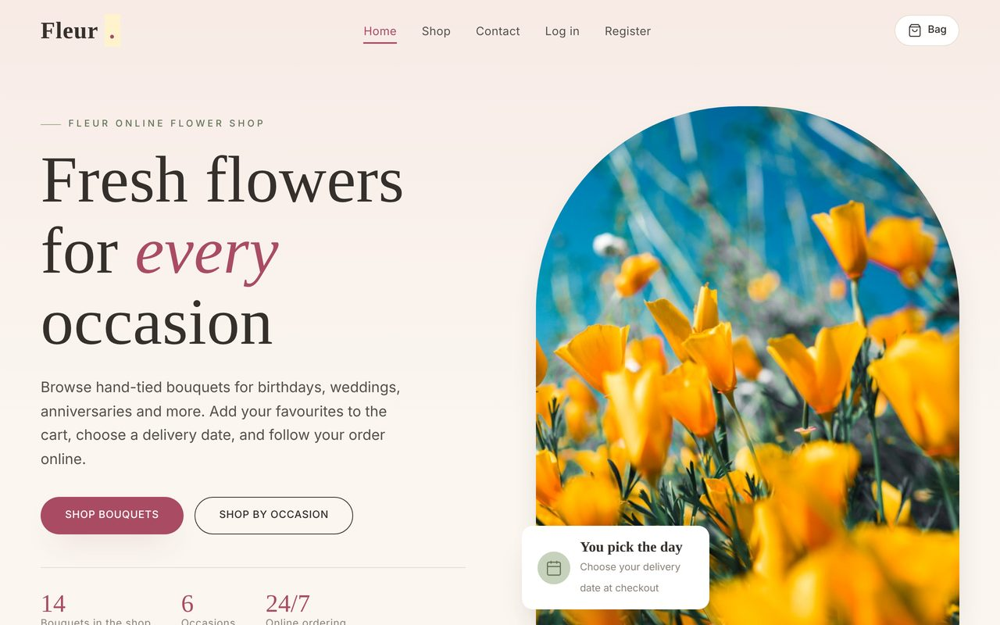
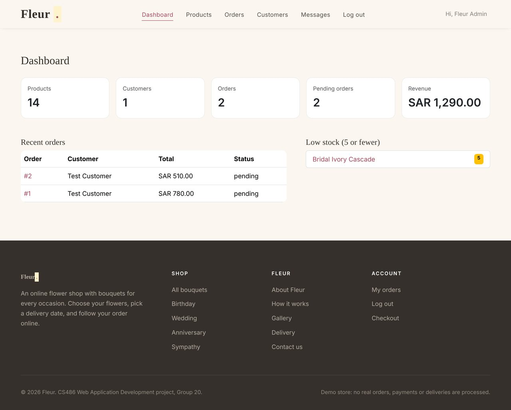

# Fleur: Online Flower Shop 🌷

Fleur is a dynamic, database-driven online flower shop. Customers browse bouquets, filter them by occasion, colour and price, add them to a live cart, check out with a delivery date, and follow their order status. Admins manage products, orders, customers and contact messages.



---

## Technologies

| Technology | Role in the project |
|---|---|
| **HTML5** | Semantic, multi-page structure: header, nav, main, section, footer, forms, tables, images |
| **CSS3** | One external stylesheet (`css/style.css`) shared by every page, responsive layout |
| **JavaScript** | Form validation, shop filters and sorting, cart drawer, DOM updates (`js/main.js`) |
| **PHP 8 (OOP)** | Authentication, sessions, form processing, business logic, data-driven pages, 8 classes |
| **MySQL / MariaDB** | 7 tables with primary keys, foreign keys and CHECK constraints, full CRUD |
| **AJAX + JSON** | Cart and newsletter work without reloading the page |
| **Bootstrap 5** | Grid and form components (self-hosted, no CDN) |

---

## Features

### Customer
- Home page with featured bouquets and occasion cards loaded from the database
- Shop with search (name and description), occasion, colour and price filters, sorting, and links that open the shop pre-filtered (`shop.php?occasion=birthday`)
- Product details page with occasion, colour, stock and Add to cart
- Slide-in cart updated with AJAX: add, change quantity, remove, live subtotal
- Register, log in and log out
- Checkout with recipient, phone, address, delivery date (tomorrow or later) and card message
- Stock checked at checkout; the order is saved in one database transaction
- Order history and order details with the current status
- Contact form and newsletter subscription
- All prices in Saudi Riyals (SAR)

### Admin
- Dashboard: products, customers, orders, pending orders, revenue, recent orders, low-stock list
- Products: add, edit and delete (full CRUD), with image upload
- Orders: filter by status and change the status. Cancelling returns stock; re-opening a cancelled order checks stock first
- Customers: list with order counts (read only)
- Messages: messages sent from the contact form (read only)

---

## Security

Each item below is implemented in the code.

- **SQL injection:** every query uses PDO prepared statements (`classes/Database.php`); ids are cast to integers
- **Passwords:** stored with `password_hash()`, checked with `password_verify()`; login pauses for 60 seconds after 5 wrong attempts in a session
- **Sessions:** `session_regenerate_id()` after login; session cookie is HttpOnly and SameSite=Lax
- **CSRF:** a token in every POST form and in the `X-CSRF-Token` header for AJAX
- **XSS:** everything printed into HTML goes through `e()` (`htmlspecialchars`)
- **Access control:** `requireAdmin()` on every admin page; customers can only open their own orders
- **Uploads:** real image type checked from the file content (JPG/PNG/WEBP, under 2 MB), random file names, and `img/uploads/.htaccess` blocks scripts
- **Errors:** PHP errors are logged, not shown; visitors never see SQL, file paths or stack traces
- **Prices:** always read from the database; prices sent by the browser are ignored

---

## Running locally with XAMPP

### Requirements
- **PHP 8.0 or newer** with these extensions enabled: **mbstring** and **PDO MySQL** (`pdo_mysql`). Both are enabled by default in XAMPP.
- **MySQL 8.0.16+ or MariaDB 10.2+** (needed for the CHECK constraints; current XAMPP releases ship MariaDB 10.4 or newer)
- Apache (included in XAMPP)
- A web browser

### Steps
1. **Install XAMPP** from apachefriends.org and open the XAMPP Control Panel.
2. **Start Apache and MySQL.**
3. **Copy the project** into the `htdocs` folder, for example `C:\xampp\htdocs\fleur` (Windows) or `/Applications/XAMPP/htdocs/fleur` (macOS). Any folder name works; links adapt automatically.
4. **Create the database:** open `http://localhost/phpmyadmin`, choose **Import**, select `database/fleur.sql` and click **Go**.
   > ⚠️ The SQL file starts with `DROP DATABASE IF EXISTS fleur;`. Importing it deletes any existing database named `fleur` and recreates it with the sample data.
5. **Configure the connection:** copy `config/database.example.php` to `config/database.php`. The default values (`root`, empty password) match a fresh XAMPP install. `config/database.php` is git-ignored, so real credentials are never committed.
6. **Open the site:** `http://localhost/fleur/`

### Demo accounts

| Role | Email | Password |
|---|---|---|
| Admin | `admin@fleur.test` | `Admin@123` |
| Customer | `customer@fleur.test` | `Admin@123` |

These are demo accounts for local testing only. Change or remove them before using the code anywhere public.

### Quick test
1. Log in as the customer, add bouquets from the shop, check out, and open **My Orders**.
2. Log in as the admin, change that order's status, and check that the customer sees the new status.
3. Cancel the order as admin and check that the stock goes back up on the Products page.

---

## Project structure

```
├── index.php             Home page
├── shop.php              Shop with search, filters and sorting
├── product.php           Product details
├── checkout.php          Delivery form, creates the order
├── my-orders.php         Customer order history
├── order-details.php     One order with its items
├── contact.php           Contact form
├── login.php · register.php · logout.php
│
├── admin/                dashboard, products, product-form, delete-product,
│                         orders, users (customers), messages
├── ajax/                 cart.php and newsletter.php (JSON)
├── classes/              Database, User, Product, Cart, Order, Contact, Newsletter, AppException
├── includes/             init.php, auth.php, form-helpers.php, header.php, footer.php
├── config/               database.example.php (copy to database.php)
├── css/ · js/ · img/     Styles, scripts, images (img/uploads/ holds admin uploads)
├── database/fleur.sql    Schema and sample data
└── docs/screenshots/     Screenshots of the running site
```

---

## Database

`users` · `occasions` · `products` · `orders` · `order_items` · `contact_messages` · `newsletter_subscribers`

- One user places many orders; one order has many items; each item refers to one product; each product belongs to one occasion.
- `order_items.unit_price` is copied at checkout, so past orders keep their original price.
- A product that appears in past orders cannot be deleted (the foreign key protects order history); set its stock to 0 instead.


---

## Screenshots

| | |
|---|---|
|  |  |
| Shop with filters | Cart updated with AJAX |
|  |  |
| Checkout | Order details |
|  |  |
| Admin dashboard | Admin order management |

More, including phone views: [docs/screenshots](docs/screenshots). The screenshots were taken from the running application with the sample data.

---

## Credits

The front-end design is based on the free **[Fleur template by uiCookies](https://uicookies.com/downloads/fleur/)** (free for personal and commercial use). Demo photos come with the template. All template marketing text has been replaced with content that describes this project's actual features.

This is a demo store: no real orders, payments or deliveries are processed.
